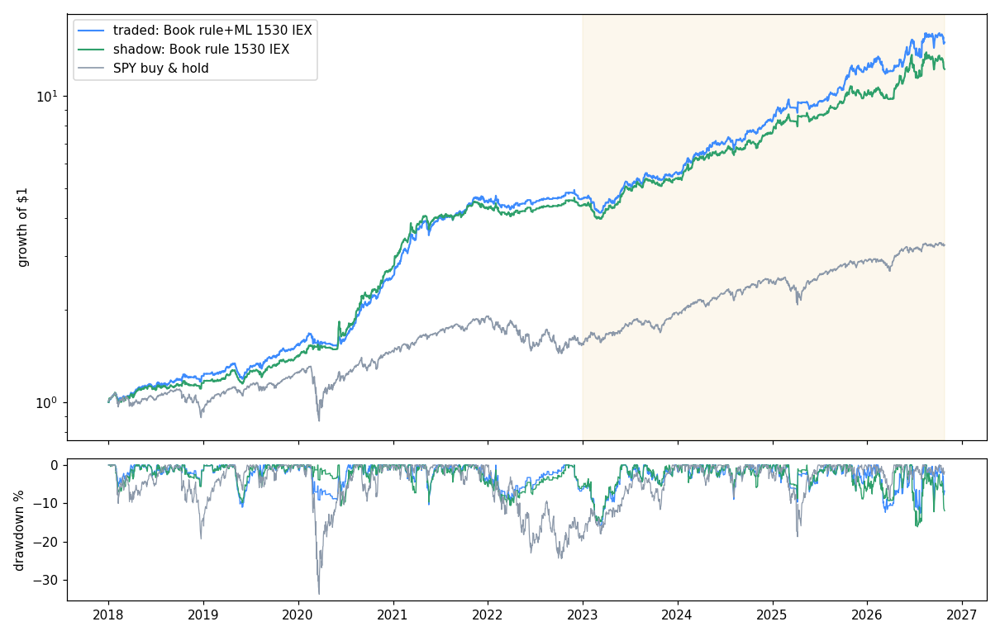

# Momentum Book: the app's results, team review and verdict (2026-10-27, updated 2026-10-28: §6, the paper account has no auctions; §7, execution as a live setting)

The research behind the book, with 3,035 variants and the selection, is in `../MOMENTUM_PREDICTION_REPORT.md`. This report covers the app built from it:
* what the app's backtest gives;
* how it reconciles with the research;
* how live is proven equal to the backtest;
* the team's verdict.

**Backtest setup.** Window 2018-01-02 → 2026-10-26; the first ML year is 2018. In-sample runs to 2022-12-30, out-of-sample from 2023-01-03. $100,000 start, whole shares, 2% cash reserve, no leverage. Costs: 1 bp per auction side; 0.5 bp half spread on the intraday market orders.

## 1. Results
| | **Traded** (rule + ML, 15:30, QQQ on IEX) | **Shadow** (rule only) | SPY buy & hold |
|---|---|---|---|
| Sharpe full / IS / OOS | **2.03 / 2.40 / 1.74** | 1.81 / 2.12 / 1.53 | 0.81 / 0.52 / 1.39 |
| CAGR full / IS / OOS | **36.1% / 36.0% / 36.2%** | 33.0% / 34.7% / 30.9% | 14.4% / 9.2% / 21.6% |
| Volatility | 15.8% | 16.5% | — |
| Max drawdown full / IS / OOS | -15.8% / -11.1% / -12.6% | -16.2% / -10.7% / -16.2% | -33.8% / -33.8% / -18.8% |
| Beta / correlation to SPY | 0.32 / 0.38 | 0.31 / 0.35 | 1 |
| Trades | 37,233 (36,213 overnight, 1,000 intraday) | 37,228 | — |

**Years** (%):

| | 2018 | 2019 | 2020 | 2021 | 2022 | 2023 | 2024 | 2025 | 2026 YTD |
|---|---|---|---|---|---|---|---|---|---|
| Traded | 22.5 | 26.3 | 67.7 | 74.2 | 3.0 | 21.9 | 46.2 | 48.3 | 22.4 |
| Shadow | 16.2 | 22.1 | 96.7 | 54.1 | 2.9 | 22.3 | 40.2 | 33.5 | 21.5 |
| SPY | -5.0 | 31.1 | 18.5 | 28.6 | -18.2 | 26.2 | 24.9 | 17.7 | 13.1 |

The traded book beats SPY in 7 of 9 years. It lags in 2019 and 2023, the steady low-volatility bull years.

**Legs** (each leg's daily P&L over the book's equity; Sharpe full / IS / OOS):
* **Overnight:** 1.81 / 2.22 / 1.53. 36,213 trades, 54.5% winners, +13.1 bp per trade after costs. Invested on 82% of nights (off when SPY is below its 200-day mean).
* **Intraday:** 1.00 / 1.04 / 0.94. 1,000 trades on 31% of days, 43% winners, +5.3 bp per trade.
  * Entries: 42% at the 10:00 check.
  * Exits: 37% in the closing auction, the rest by the band/VWAP trail.
  * Data: IEX bars on the 706 sessions where they are cached (2024 on); SIP bars on the 1,510 before.

**Sensitivity** (traded book, one change at a time; Sharpe full / IS / OOS):

| Change | Sharpe | CAGR | Max DD |
|---|---|---|---|
| auctions 2 bp per side | 1.75 / 2.10 / 1.48 | 30.2% | -16.6% |
| auctions 3 bp per side | 1.47 / 1.79 / 1.21 | 24.5% | -17.3% |
| intraday half spread 1 bp | 1.97 / 2.33 / 1.70 | 34.9% | -16.0% |
| k = 10 | 2.10 / 2.39 / 1.89 | 44.6% | -18.2% |
| k = 30 | 1.96 / 2.38 / 1.61 | 31.3% | -13.9% |
| no SPY trend filter | 1.64 / 1.65 / 1.62 | 36.4% | -29.8% |
| intraday on SIP instead of IEX | 2.05 / 2.40 / 1.80 | 36.7% | -15.8% |

## 2. Reconciliation with the research
* **Rule book, 15:45, SIP intraday, the research's universe.** The app gives **1.98 / 2.37 / 1.58** (research: 1.97 / 2.36 / 1.57). The CAGR is 33.7% against 34.6% because of the 2% cash reserve.
* **Rule + ML, 15:30, SIP intraday.** The app gives **2.05 / 2.40 / 1.80** (research: 2.09 / 2.41 / 1.84). The differences are deliberate:
  * **Universe.** 80 top-150 members (ranks 103–150, 2.6% of member-months) had no 15-minute bars in the research. Their bars were downloaded (`research/mp_fill_bars.py`) because live will see them; this costs about 0.04–0.09 Sharpe.
  * **Execution.** Whole shares, a 2% cash reserve, and QQQ never bought overnight (one order per symbol per auction).
  * **Data timing.** "Today's open" in the features and the noise band is the first 15-minute bar's open, which live can read; the official open is not readable before the close.
  * **Noise band.** It needs 7 of the last 14 sessions instead of all 14, so a 13:00 close no longer blinds the afternoon checks for three weeks.
  * **Ties.** Equal blended ranks go to the ticker order.
* **IEX intraday (the traded preset).** 2.03 / 2.40 / 1.74. The free real-time feed costs about 0.03 Sharpe over SIP, all of it after 2024; the intraday leg's OOS Sharpe falls from 1.13 to 0.94.

## 3. Live = backtest
* **One code path.** The backtest and the live engine call the same functions: `MomMarket`, `prepare()` (features, rankable names, SPY trend, ML forecast), `decide_overnight()`, `noise_upper()` / `noise_action()`, and the same sizing (`intraday_shares`, 98% / k per name).
* **ML models.** One file per year, written once. The backtest predicts year Y with the year-Y file, and live loads the current year's file.
* **Tests.** `core/tests/test_mom.py` has 13 tests, fakes only (synthetic bars, simulated broker; no network, keys or orders). Four replay a backtest session by session through the live engine: morning, opening auction, every 30-minute check, the 15:46 decision, closing auction, after-close step. Every fill must equal a backtest trade and the final equity must match to 1e-9:
  * rule book with IEX intraday, including an SPY down-leg (trend filter off) and early closes;
  * rule + ML book with the rule book in the shadow. The shadow's picks equal the rule book's, and the shadow report is complete;
  * overnight leg alone at 15:45 on the real-time SIP;
  * intraday leg alone on SIP.

  The other tests cover:
  * features from a 460-day live window equal the full-history features (< 1e-6, float32);
  * ranking and tie-break; the blend; noise-rule edge cases;
  * no leverage; the trade list accounting for every dollar;
  * dry run sends nothing; past the MOC cut-off is refused; a late check is skipped;
  * the feed/time problems and a missing ML model are refused when arming.
* **Check live vs backtest.** The GUI button rebuilds every journaled decision and check from the backtest's data. In the replay it reports everything identical.
* **Real data, dry run (2026-10-27 17:40 ET).** Read-only: account, clock and bars, nothing armed.
  * Pre-flight all OK.
  * The 2026 model loaded: 445,731 rows, 2016-01-05 .. 2025-12-30.
  * The overnight plan was built in 8.4 s: 20 market-on-close buys of about $4.8k each.
  * The 15:30 intraday check read the IEX bars in 0.2 s and gave a QQQ buy signal (721.57 > band 720.57).

## 4. Team review
**DA 🗄️ (Data Architect).**
* **Data coverage.** The free plan is enough: delayed SIP at 15:46 for the overnight leg, real-time IEX for the intraday leg.
* **Filled gap.** 80 members had no intraday bars; they were downloaded, so the backtest's universe now equals the one live sees.
* **Live data handling.**
  * The morning step tops up the daily and 15-minute caches, re-downloading a symbol whose adjusted history changed.
  * The decision rescales cached daily history to the broker's latest adjustment (it did so for ASML, GEV and NOK in the dry run).
* **IEX history** starts 2024-01-02; before that the backtest's intraday leg runs on SIP and says so per session.

**QR 🔬 (Quant Researcher).**
* **The ML forecast earns its place.** OOS 1.74 vs 1.53 for the rule, the overnight leg 1.53 vs 1.31, with the same intraday leg.
* **k = 10** looks better still (OOS 1.89).

**Valid 🛡️ (Code Validator)**, disagreeing with QR on k = 10.
* **k = 10 is an out-of-sample pick.** It was found by looking at the OOS window, so the presets stay at the research's in-sample choice (k = 20).
* **Model-selection bias.** The ML gain was +0.18 OOS Sharpe (SE 0.21) at 15:30 in the research. The app's +0.21 is the same evidence, not new evidence.
* **Not Sharpe 2 out-of-sample.** The traded book is at 1.74. Over all 3,035 + 1,871 trials the deflated Sharpe is 0.35, and P(OOS Sharpe > 2) is about 0.4.
* **What is signed off:** the app is correct (parity tests, accounting test, reconciliation). The strategy is signed off for **paper only**.

**RM 🔒 (Risk Manager).**
* **Costs are the main risk.** At 3 bp per auction side the book falls to 1.47 / 1.21 OOS.
* **Measure costs on paper.** Track the opening and closing auction fills against the official prints; the journal records both. Stop the paper test if the realised cost is above 2 bp per side over 40 sessions.
* **Drawdown.** -15.8% max (-12.6% OOS), against SPY's -33.8%. Beta 0.32.
* **Trend filter.** Without it the drawdown doubles to -29.8%.
* **Limits.** No capital before a 3-month paper record. The live overlays should be set on paper: daily-loss halt 4%, drawdown stop 20%.

**QT ⚡ (Quant Trader).**
* **Auction execution.** Twenty $5k market-on-close orders at 15:46 and twenty OPG sells are routine.
* **Intraday fills.** The leg buys QQQ at market a few seconds after a 30-minute bar ends. Expect slippage against the bar close of 0.5–2 bp; the backtest assumes 0.5 bp, and 1 bp costs 0.06 Sharpe.
* **PDT.** The leg needs the margin account above $25k.
* **QT vs Dev, decision timing.** QT wanted the decision at 15:45 for fresher prices. Dev pointed out that 15:45 needs the paid real-time SIP, and the research found 15:30 as good. QT accepted 15:30.

**PM 👑 (Portfolio Manager).**
* **Fit with the other books.** It is the first book in this project that beats SPY buy & hold out-of-sample with lower risk: 36% vs 22% OOS CAGR, -12.6% vs -18.8% OOS drawdown. It is diversifying (correlation 0.38).
* **Account.** Paper on its own account: MeanReversion may use the project's paper account, and the account registry refuses a second strategy on it.

## 5. Verdict and next step
* **Status.** The app is built, tested and dry-run on real data. It is **not** Sharpe 2 out-of-sample (1.74), but it beats SPY in every window with half the drawdown.
* **Recommendation.** Paper-trade the traded preset with the rule-only shadow for 3 months, on its own paper account (or after stopping MeanReversion's paper loop).
* **Acceptance before any capital:**
  * ≥ 98% of overnight orders and intraday actions identical in *Check live vs backtest*;
  * realised auction cost ≤ 2 bp per side;
  * intraday slippage ≤ 2 bp;
  * no engine incidents (missed decisions, stuck orders).
* **Real money** stays disabled in code until Valid signs off on the paper record.

## 6. Update 2026-10-28: the paper account has no auctions
**What happened.** On the first armed day the 15:46 decision was right: 20 of 20 orders and 12 of 12 QQQ checks matched the backtest. But only **6 of 20 market-on-close buys filled**, 4 of them partly: 135 of 980 shares, $20.1k of $96.0k.
* Every fill was stamped 15:59:55–15:59:58 at the quote: 2.6 bp below to 21.7 bp above the official close.
* The rest expired at 16:00.
* Alpaca staff confirm this on their forum: paper treats MOC/MOO orders like market orders at the quote, with random partial fills, and the remainder expires. A June 2026 thread shows the same pattern.

**Fix: execution is part of the model** (`MomModel.execution`), so backtest and live share it.

| | `auction` | `market` (paper presets) |
|---|---|---|
| Orders | MOC 15:46, OPG 08:45 | queued at 15:46; market orders **30 s before the close** (QQQ sale and exits first, then the buys) and **60 s after the open** |
| Backtest price | official close / open | official close / open |
| Backtest cost per side | 1 bp | **3.4 bp** at the close, **10 bp** at the open, QQQ sale 0.5 bp |
| Live (`auto`) | real money | paper, or any `market` model |

* **Guard.** Nothing is sent in the last 2 s before the close, because a DAY order that reaches Alpaca after 16:00 trades at the next open.

**Measured costs.** SIP NBBO quotes of the book's own picks were sampled over 60 sessions (2026-07-31 → 10-23, 1,200 fills per point) against the **raw** official prices. The adjusted prices first produced fake outliers: an APH split, and dividend gaps on 17% of rows. SE is across days.

| Buy at the ask, before the close | 120 s | 60 s | **30 s** | 10 s |
|---|---|---|---|---|
| cost (bp) | 3.2 ± 0.9 | 3.0 ± 0.7 | **3.4 ± 0.6** | 1.9 ± 0.3 |
| half spread | 1.7 | 1.5 | 1.4 | 2.0 |

| Sell at the bid, after the open | 5 s | 10 s | 30 s | **60 s** | 120 s | 5 min | 10 min | 15 min |
|---|---|---|---|---|---|---|---|---|
| cost (bp) | 18.8 ± 1.7 | 17.8 ± 2.0 | 12.6 ± 3.1 | **9.8 ± 3.8** | 11.1 ± 5.3 | 16.1 ± 7.0 | 7.2 ± 7.7 | 2.7 ± 8.7 |
| half spread | 19.3 | 19.2 | 17.8 | 15.7 | 13.3 | 9.9 | 7.9 | 7.0 |

10 s before the close is cheapest, but 20+ orders under the 150-calls/min limit need about 8 s, so the book uses 30 s. Later sales after the open are cheaper on average but drift further from the open.

**The edge lives in the auctions.** Top-k sweep, 2018-01 → 2026-10, Sharpe full / IS / OOS, CAGR, max drawdown, mean overnight trade after costs:

| rule + ML | k = 5 | k = 10 | k = 15 | k = 20 |
|---|---|---|---|---|
| auction (1 bp) | 2.09 / 2.31 / 1.97 · 54.1% · -20.0% · +19.7 bp | 2.04 / 2.31 / 1.85 · 43.1% · -18.6% · +15.7 bp | 2.09 / 2.47 / 1.80 · 39.8% · -15.5% · +14.4 bp | 2.06 / 2.40 / 1.80 · 36.8% · -15.2% · +13.3 bp |
| market (3.4 / 10 bp) | **1.04 / 1.15 / 0.98 · 22.6% · -28.4% · +8.3 bp** | 0.81 / 0.99 / 0.65 · 14.0% · -26.9% · +4.3 bp | 0.73 / 1.02 / 0.48 · 11.3% · -22.1% · +3.0 bp | 0.63 / 0.87 / 0.42 · 9.0% · -20.6% · +1.9 bp |

| rule only | k = 5 | k = 10 | k = 15 | k = 20 |
|---|---|---|---|---|
| auction | 1.76 / 1.77 / 1.77 · 49.2% · -31.1% | 1.81 / 1.94 / 1.70 · 40.5% · -22.3% | 1.75 / 2.08 / 1.44 · 34.3% · -17.7% | 1.81 / 2.11 / 1.53 · 32.8% · -15.7% |
| market | 0.82 / 0.84 / 0.81 · 18.7% · -43.8% | 0.66 / 0.78 / 0.54 · 11.8% · -35.4% | 0.47 / 0.78 / 0.17 · 7.0% · -28.9% | 0.43 / 0.71 / 0.14 · 5.8% · -27.0% |

SPY buy & hold over the same window: Sharpe 0.81, CAGR 14.4%, max drawdown -33.8%.

* **With auctions, k is a risk-appetite choice.** Sharpe is flat (2.04–2.09). Fewer names add CAGR and drawdown.
* **With market orders, fewer names are clearly better.** The cost per name is fixed, while the edge is concentrated in the top ranks.

**More ML features (MA, RSI, MACD, ADX, Bollinger, stochastic, ATR).** Ten indicators were added to the 36 inputs, known at 15:30:
* RSI(14) and RSI(2) including today's 15:30 price;
* MACD histogram / price;
* ADX(14) and +DI − DI;
* Bollinger %b(20);
* close / SMA50 and SMA50 / SMA200;
* stochastic(14);
* ATR(14) / price.

They were run through the same walk-forward yearly models (fitted on the years before). Both feature sets were refitted in the same run.

| | daily rank IC IS (t) | IC OOS (t) | market k=5 | k=10 | k=15 | k=20 |
|---|---|---|---|---|---|---|
| 36 features (current) | 0.0507 (7.7) | 0.0437 (5.4) | 0.97 / 0.99 / 0.98 | 0.77 / 0.91 / 0.67 | 0.73 / 0.87 / 0.62 | 0.61 / 0.80 / 0.44 |
| 36 + 10 technical | 0.0534 (8.2) | 0.0452 (5.6) | 0.93 / 1.11 / 0.80 | 0.88 / 1.03 / 0.76 | 0.82 / 0.94 / 0.74 | 0.62 / 0.76 / 0.49 |

The paired daily-return difference (extended − current) is not significant anywhere: k=5 IS t +0.67, OOS t -0.88; k=10 +1.00 / +0.48; k=20 -0.46 / +0.50.

With auction execution the picture is the same:

| | k=5 | k=10 | k=15 | k=20 |
|---|---|---|---|---|
| current features | 1.98 / 2.10 / 1.93 | 1.98 / 2.24 / 1.81 | 2.07 / 2.32 / 1.90 | 2.04 / 2.33 / 1.83 |
| + 10 technical | 1.96 / 2.23 / 1.77 | 2.09 / 2.34 / 1.92 | 2.17 / 2.37 / 2.04 | 2.05 / 2.28 / 1.89 |

The paired t-stats are again at most 1.0, and the sign flips at k=5. The refitted current-feature forecast correlates 0.90 with the saved yearly files. The data has been topped up and filled since they were fitted, so the forecast moves with data revisions. Live and the backtest both use the saved files, so parity holds.

**Order times set by the owner: 15:59:50 and 09:29:50** (later 09:27:00, before Alpaca's 09:28 cut-off for the opening cross; the backtest moved to the actual quotes - see below). The paper presets now send the closing orders at 15:59:50, in parallel, sells first. Last night's names are sold with market orders sent at 09:29:50 and queued for the open. Backtest prices, measured as above:
* **Closing buy at 15:59:50:** 1.9 bp, the cheapest time measured.
* **Sale sent at 09:29:50:** about **19 bp**. The order waits for the open and fills at the first quotes, where the half spread is 19 bp; the measured cost is 18.8 bp at 09:30:05.

| Execution (Sharpe full / IS / OOS · CAGR · max DD · mean night) | k = 5 | k = 10 | k = 20 |
|---|---|---|---|
| **15:59:50 / 09:29:50 (1.9 / 19 bp), rule + ML** | 0.35 / 0.39 / 0.32 · 5.4% · -33.9% · +0.8 bp | -0.02 / 0.11 / -0.14 · -2.0% · -39.4% · -3.2 bp | -0.32 / -0.14 / -0.50 · -5.9% · -48.2% · -5.6 bp |
| 15:59:30 / 09:31:00 (3.4 / 10 bp), rule + ML | 1.04 / 1.15 / 0.98 · 22.6% · -28.4% · +8.3 bp | 0.81 / 0.99 / 0.65 · 14.0% · -26.9% · +4.3 bp | 0.63 / 0.87 / 0.42 · 9.0% · -20.6% · +1.9 bp |
| auction (1 bp), rule + ML | 2.09 / 2.31 / 1.97 · 54.1% · -20.0% · +19.7 bp | 2.04 / 2.31 / 1.85 · 43.1% · -18.6% · +15.7 bp | 2.06 / 2.40 / 1.80 · 36.8% · -15.2% · +13.3 bp |

On the paper account the 09:29:50 sale loses the overnight edge to the opening spread. On a real Alpaca account, the docs say a market order received **before 09:28** is filled at the Nasdaq official opening price; one received between 09:28:01 and 09:29:59 misses that cross. 09:29:50 is therefore too late for the auction price there too, and 09:27:xx would get it. The paper simulator fills any pre-open market order at the opening quotes, so paper cannot show the difference.

**Backtest at the actual historical quotes (final, 2026-10-28).** The paper presets now trade at 15:59:50 and 09:27:00. The backtest fills every market order at the SIP quote of its moment:
* buys at the **ask at 15:59:50**;
* the opening sales at the **bid at 09:30:10**, where paper fills an order queued before the open;
* the QQQ closing sale at the **bid at 15:59:50**.

The cache holds 104,185 quotes for every day's picks of both rankings at k = 5 to 20, 2018-01 to 2026-10. It priced **99.8%** of the fills; the rest fall back to the average cost.

| Fills (rule + ML) | k = 5 | k = 10 | k = 20 |
|---|---|---|---|
| **historical quotes** | **0.73 / 0.83 / 0.67 · 14.8% · -27.6% · +4.8 bp** | 0.56 / 0.76 / 0.37 · 9.1% · -25.1% · +1.9 bp | 0.46 / 0.72 / 0.23 · 6.3% · -24.0% · +0.3 bp |
| average cost 1.9 / 17.8 bp | 0.46 / 0.52 / 0.42 · 7.9% · -32.7% · +2.0 bp | 0.11 / 0.25 / -0.01 · 0.4% · -34.5% · -2.0 bp | -0.17 / 0.02 / -0.36 · -3.8% · -42.2% · -4.4 bp |
| auctions (1 bp) | 2.09 / 2.31 / 1.97 · 54.1% · -20.0% · +19.7 bp | 2.04 / 2.31 / 1.85 · 43.1% · -18.6% · +15.7 bp | 2.06 / 2.40 / 1.80 · 36.8% · -15.2% · +13.3 bp |

The rule-only book at the historical quotes: 0.57 (k = 5), 0.41 (k = 10), 0.23 (k = 20).

Measured over the whole period:
* **ask at 15:59:50 vs the official close:** 1.5–2.5 bp every year;
* **bid at 09:30:10 vs the official open:** 9–14 bp a year in 2018–2024, then **16.6 bp in 2025 and 19.1 bp in 2026**, as the picks moved to more volatile names.

The 60-session average (17.8 bp) therefore overstated the history. Real quotes still leave market orders with a small fraction of the auction edge.

**Safety review (Valid, 2026-10-28).** An independent read-only review of the live engine found 1 critical, 3 high, 4 medium and 4 low issues. All of them are fixed and covered by tests:
1. **Critical:** a failed QQQ closing sale no longer lets the overnight buys go out (that would have held about 2x overnight). A failed exit drops the lowest-ranked buys worth it.
2. Every loop, dry or armed, holds the account lock.
3. **KILL**
   * disarms;
   * blocks the rest of the day;
   * never double-sells a symbol whose earlier order could not be cancelled;
   * refuses another strategy's account;
   * uses market orders, not OPG.
4. **MOC/MOO opening sales** go out before the data top-up, and anything the opening auction leaves is sold with a market order at 09:31.
5. A missed decision sells last night's book (and QQQ under MOC/MOO) before the close.
6. No order is sent in the last 2 seconds, there are no automatic resubmits, and the session's leftover orders are cancelled after the close.
7. Live fills are compared with **raw** official prices.
8. **Smaller fixes:**
   * the quote cache repairs incomplete rows;
   * reconcile P&L uses the filled shares;
   * a failing reconcile no longer blocks the next day;
   * the intraday checks save the risk state;
   * labels are corrected.

Valid's re-review found one regression and four gaps, all fixed with tests:
* **The regression:** the opening-sale retry could sell an opening-auction order still running a second time. Sales are now netted against the book's open orders, and nothing is cancelled.
* KILL orders queued after the close are netted the next morning, and nothing is sent while they are open.
* A dry loop's step flags are kept apart from the armed loop's.
* The daily-loss base comes from the same account read.
* Every order re-checks ARM and KILL.

Valid's final check found no critical, high or medium defects. Two of its low notes were fixed:
* the decision's exits are re-sized against open orders when they are sent;
* KILL now stays active until a person clears it.

The third note is documented: under MOC/MOO, an opening order that expires after 09:31 is not retried, and its name is sold at the close.

**Team review (2026-10-28).**
* **DA 🗄️.**
  * Quotes are raw prices and the backtest's prices are adjusted. Costs must be measured against the raw official prices, as done here.
  * The forecast's 0.90 correlation after a refit is a data-revision effect to watch. Refit only in January, as planned.
* **QR 🔬.**
  * The overnight edge (+13 bp a night at k = 20) is smaller than crossing the opening spread (16–19 bp half spread in the first minute). Only the auctions deliver it.
  * The extra indicators mostly restate inputs the model already has: close/SMA20 and SMA200, 5–63-day returns, 20/60-day volatility, range, 52-week high, IBS, gap. The IC gain is +0.003.
* **Valid 🛡️.**
  * Features: 8 comparisons, no t above 1.0, and a sign flip at k=5. **Rejected.** The k=15 OOS 2.04 is the best of eight cells, not evidence.
  * k: under auctions Sharpe is flat across k, so k is a risk-appetite choice, not a finding. Under market orders the gain from a smaller k has a structural cause (a fixed cost per name, the edge concentrated in the top ranks), and IS agrees.
  * The market-order book (0.63 at k = 20) is **not deployable**.
* **RM 🔒.**
  * k = 5 puts 20% of the book in each name overnight, so a -25% gap costs 5% of equity.
  * The picks cluster: on 10-28 about half were semiconductors / optical networking.
  * RM accepts k ≥ 10. A smaller k needs a sector cap first.
* **QT ⚡.**
  * The book needs real auction access. Alpaca paper has none. An Alpaca staff post says live MOC orders are "not generally supported" without their elite smart router, while users report live MOC fills of 100%; this must be confirmed with Alpaca before any capital. Interactive Brokers routes MOC / MOO natively.
  * Until then the paper book tests the engine (decisions, timing, order flow, fills against the measured costs), not the edge.
* **PM 👑.**
  * Keep the 36 features.
  * Keep paper-trading the `market` presets as an engine test, and judge them on decision parity, fill rates and fill cost against 3.4 / 10 bp, not on P&L.
  * The real-money candidate stays the auction book, conditional on QT confirming auction routing.
  * k for both presets is the owner's choice: 20 (a priori) or 10. At 10 the auction book gains +6 pp CAGR for -3 pp drawdown, and the market book's Sharpe goes from 0.63 to 0.81.

## 7. Update 2026-10-28 evening: execution is a live setting, not part of the model

The owner asked for the original models, with the order type as the only difference.

**What changed.**
* The model has no execution fields any more: `execution`, `mkt_close_s`, `mkt_open_s` and the market-order costs are gone.
* The presets are the original books again: Traded (rule + ML) and Shadow (rule only), both with MOC / MOO orders at 1 bp per side. The separate "Auction orders" preset is gone, and a saved GUI setting that named it opens Traded.
* The backtest prices the auctions only.
* The live tab's **Auction orders** box replaces only the model's auction orders, on paper and real money alike:
  * **MOC / MOO orders, as the model** (default);
  * **market DAY orders 5 s before the close (15:59:55) and 3 minutes before the open (09:27:00)**.
* The intraday checks' QQQ orders are market orders under both choices. The box is greyed out for a model with no auction order.
* `book_view` and `fill_report` compare every fill with the auction price. With market orders, the `diff` column is what they cost against the model.
* The headless runner takes the choice saved with `live_model.json`.
* `quotes.py` stays as the research tool behind §6. The app no longer uses it.

**Safety.**
* The 5-second margin leaves about 3 s before the 2-second cut-off, and sending 20 orders in parallel takes about 1 s.
* The loop now ticks on the whole second, so the 15:59:55 step starts at 15:59:55.0, not up to a second late.
* Pre-flight compares the PC clock with Alpaca's; it measured within 0.003 s on 10-28. A gap over 1 s is a warning.

**QQQ leg, 10-28.**
* The live loop ran all 12 checks 5–7 s after each bar's end.
* Re-reading the IEX bars now gives the same price and band to the cent at every check, and so does the backtest's data.
* QQQ closed every 30-minute bar 0.47–1.10% below the band: its best close was 723.68 against a band of 729.76 at 15:00. It never even closed above its own open of 724.05, while the band started 0.25% above the open at 10:00 and widened to 0.8%.
* Over the last 15 sessions, the live data path and the backtest made identical QQQ decisions. 6 of the 15 sessions traded, 10 round trips in all.

**Tests.** The market-order replay now uses the same MOC/MOO model. Filled at the auction prices by the simulated broker, it reproduces the backtest exactly: the same orders as the MOC replay, all of type `day`, the closing ones at 15:59:55 with sells before buys, and the opening sales at 09:27:01.

**Only the book's own shares (owner, 2026-10-28).** Earlier, every position in the book's 476 tickers counted as the book's, including the top-150 stocks of every month, the 59 ETFs and QQQ. A hand-bought AAPL would have been sold at the next open.
* Now `held_positions()` takes, per symbol, the smaller of the broker's position and the book's own net shares. Those are its filled buys minus its filled sales from the broker's order history (client ids `MB-...`), in fill order, never below zero.
* The order history is cached: each call re-reads only the orders that can still change and the new ones.
* Every sale goes through this: the morning sale, the decision's exits and the QQQ sale at the close. So do KILL, the book's capital and the after-close rebuild of the book.
* The rest of the account is reported as "not this book's" and never touched.
* Read-only check on the paper account: the book's own shares from its order history are exactly the 6 positions held. With 10 AAPL, 7 extra MU and 10 ZZZZ added as if bought by hand, the 09:27 step still sells only those 6 positions (MU 5, not 12).
* A new test covers a hand-bought position in a book ticker, extra shares on top of the book's and a hand-bought QQQ, under both order types. None of them is sold by the morning step or KILL, none is counted in the capital, and with no position of its own the book sends nothing.

**Wider universe probe: top-500 + ETFs as an S&P 500 proxy (owner's question, 2026-10-28; `research/mp_universe_probe.py`).**
* There is no point-in-time S&P 500 membership in the data, and today's list would add survivorship bias. The top-500 by liquidity, re-ranked each month, is the honest proxy.
* Only the top-150's names have 15-minute bars, so the probe ranks by today's move to the **close**. That is look-ahead, and it is calibrated on the top-150, where the honest 15:45 signal gives 1.77 and the proxy 1.44. The probe uses rule only, k = 20, the SPY filter, the overnight leg alone and 1 bp per side. Sharpe full / IS / OOS:

| Universe (close proxy) | Sharpe | CAGR | Max DD | Avg night | Picks' median ADV |
|---|---|---|---|---|---|
| top-150 + ETFs | 1.44 / 1.82 / 1.05 | 21.9% | -27.3% | +9.8 bp | $619M |
| top-500 + ETFs | 1.34 / 1.58 / 1.06 | 22.4% | -32.7% | +10.1 bp | $254M |
| ranks 151–500 only | 1.02 / 1.25 / 0.73 | 14.4% | -27.6% | +6.8 bp | $182M |
| top-500 + ETFs, 3 bp per side | 0.81 / 1.02 / 0.57 | 12.4% | -35.7% | | |

* The extra 350 names carry a weaker overnight edge and trade 2–3x less, so their auctions are thinner and cost more than 1 bp.
* In-sample the wider universe is worse (1.58 vs 1.82) and its drawdown is deeper. The research's 50 / 100 / 150 comparison (1.92 / 1.87 / 1.97) showed no gain from breadth either.
* **Verdict:** not pursued. The full test would need 15-minute bars for about 1,000 more names (3–5 hours of downloads) and an ML refit; the in-sample evidence does not justify it.

**Weekly re-ranking probe (owner's question, 2026-10-28; `research/mp_universe_weekly_probe.py`).** Same close proxy and settings as above. Each universe is rebuilt from daily bars, re-ranked monthly or weekly (the list known at the last session of a month or week is used for the next one):

| Universe + ETFs | Sharpe (full / IS / OOS), 1 bp | at 3 bp | Max DD | Avg night | Picks' median ADV | New names per re-rank | Names ever |
|---|---|---|---|---|---|---|---|
| top-150 monthly | 1.45 / 1.84 / 1.05 | 0.86 | -27.3% | +9.9 bp | $618M | 7.6 | 416 |
| top-150 weekly | 1.43 / 1.80 / 1.05 | 0.85 | -27.1% | +9.8 bp | $626M | 2.6 | 427 |
| top-500 monthly | 1.34 / 1.58 / 1.06 | 0.81 | -32.7% | +10.2 bp | $254M | 17.8 | 1,110 |
| top-500 weekly | 1.35 / 1.67 / 0.96 | 0.83 | -32.8% | +10.5 bp | $257M | 6.3 | 1,141 |

* **Weekly re-ranking changes nothing.** A 3-month median moves slowly, so a week swaps only 2–3 names of the top-150.
* **Top-500 stays worse** in-sample, with a 5-point deeper drawdown, whether re-ranked monthly or weekly.
* **A real build would need:**
  * 15-minute bars for about 720 more names (3–5 hours of downloads);
  * an ML refit on about 3x the rows;
  * a weekly universe file and a weekly live update;
  * a 3x larger 15:30 read.
* **Verdict:** not pursued; keep top-150 monthly.

**k = 1 … 20 (owner's question, 2026-10-28).** The traded model through the app's engine: rule + ML at 15:30, MOC / MOO at 1 bp, QQQ intraday, 2018-01 → 2026-10. `t vs k=20` is the paired t of the daily return difference.

| k | Sharpe full / IS / OOS | CAGR | Vol | Max DD | Avg night | Worst overnight night | Weight per name | t vs k=20 |
|---|---|---|---|---|---|---|---|---|
| 1 | 1.68 / 1.83 / 1.56 | 79.6% | 39.4% | -30.7% | +29.9 bp | -26.5% | 98% | 3.04 |
| 2 | 1.89 / 2.10 / 1.74 | 68.5% | 30.0% | -26.5% | +25.2 bp | -13.7% | 49% | 3.34 |
| 3 | 2.04 / 2.28 / 1.89 | 63.9% | 25.8% | -21.9% | +23.3 bp | -8.7% | 32.7% | 3.74 |
| 4 | 2.09 / 2.37 / 1.91 | 58.4% | 23.3% | -22.5% | +21.3 bp | -7.0% | 24.5% | 3.77 |
| 5 | 2.09 / 2.31 / 1.97 | 54.1% | 21.8% | -20.0% | +19.7 bp | -6.6% | 19.6% | 3.59 |
| 6 | 2.15 / 2.44 / 1.95 | 53.4% | 20.9% | -17.9% | +19.4 bp | -7.1% | 16.3% | 3.91 |
| 7 | 2.05 / 2.39 / 1.79 | 48.4% | 20.2% | -19.0% | +17.7 bp | -7.0% | 14.0% | 3.22 |
| 8 | 2.09 / 2.40 / 1.84 | 47.4% | 19.5% | -19.1% | +17.3 bp | -7.0% | 12.2% | 3.36 |
| 9 | 2.10 / 2.40 / 1.88 | 46.1% | 18.9% | -18.7% | +16.8 bp | -6.8% | 10.9% | 3.36 |
| 10 | 2.04 / 2.31 / 1.85 | 43.1% | 18.4% | -18.6% | +15.7 bp | -6.7% | 9.8% | 2.66 |
| 11 | 2.08 / 2.37 / 1.87 | 42.8% | 17.9% | -18.4% | +15.6 bp | -6.8% | 8.9% | 2.82 |
| 12 | 2.11 / 2.34 / 1.97 | 42.7% | 17.5% | -16.6% | +15.5 bp | -6.7% | 8.2% | 3.11 |
| 13 | 2.12 / 2.41 / 1.91 | 42.0% | 17.3% | -16.4% | +15.3 bp | -6.7% | 7.5% | 3.14 |
| 14 | 2.14 / 2.43 / 1.93 | 41.7% | 16.9% | -15.9% | +15.1 bp | -6.9% | 7.0% | 3.32 |
| 15 | 2.09 / 2.47 / 1.80 | 39.8% | 16.7% | -15.5% | +14.4 bp | -7.1% | 6.5% | 2.44 |
| 16 | 2.10 / 2.46 / 1.82 | 39.4% | 16.5% | -15.1% | +14.3 bp | -7.3% | 6.1% | 2.46 |
| 17 | 2.08 / 2.48 / 1.77 | 38.5% | 16.3% | -15.0% | +13.9 bp | -7.1% | 5.8% | 1.89 |
| 18 | 2.07 / 2.44 / 1.77 | 37.6% | 16.1% | -15.0% | +13.6 bp | -7.0% | 5.4% | 1.12 |
| 19 | 2.05 / 2.41 / 1.76 | 37.0% | 16.0% | -15.2% | +13.4 bp | -7.1% | 5.2% | 0.43 |
| 20 | 2.06 / 2.40 / 1.80 | 36.8% | 15.8% | -15.2% | +13.3 bp | -7.0% | 4.9% | – |

* From k = 3 up, Sharpe is flat at 2.04–2.15 (standard error about 0.6 over 8.8 years). The best cells, k = 6 and k = 14, are the best of 20 tries, not a finding.
* A smaller k buys more return with proportionally more volatility. The return gain over k = 20 is significant (t about 3), but the risk-adjusted return is not.
* At k ≤ 2 Sharpe falls (1.68, 1.89), and the worst night reaches -14% to -27% of the book.
* **k is a risk dial.** k = 8 sits on the plateau: 47% CAGR, -19% drawdown, 12% per name. It is below RM's floor of k ≥ 10 without a sector cap.

**Sector cap (RM's condition for k < 10; added 2026-10-28).**
* The new model field `sector_cap` (0 = off) allows at most N overnight names per sector, in score order. A skipped name's place goes to the next-best name of another sector.
* The sectors are the universe file's 11 (Tech, Fin, Health, ...). Sector ETFs (SMH, XLK, KRE, ...) count in their sector; broad, country, bond and commodity ETFs count in none.
* Backtest and live use the same function and the same sector file. A replay test proves parity with a capped book.

Traded model (rule + ML, 15:30, MOC / MOO 1 bp, QQQ intraday), 2018-01 → 2026-10. `t vs uncapped` is the paired t of the daily return difference against the same k uncapped.

| k | cap | Sharpe full / IS / OOS | CAGR | Vol | Max DD | Avg night | Worst overnight night | Tech share of picks | t vs uncapped |
|---|---|---|---|---|---|---|---|---|---|
| 5 | off | 2.09 / 2.31 / 1.97 | 54.1% | 21.8% | -20.0% | +19.7 bp | -6.6% | 36% | |
| 5 | 2 | 2.11 / 2.37 / 1.86 | 49.1% | 19.9% | -19.0% | +17.9 bp | -6.8% | 27% | -1.50 |
| 6 | off | 2.15 / 2.44 / 1.95 | 53.4% | 20.9% | -17.9% | +19.4 bp | -7.1% | 36% | |
| 6 | 3 | 2.27 / 2.44 / 2.14 | 53.2% | 19.6% | -17.8% | +19.2 bp | -6.5% | 30% | -0.23 |
| 8 | off | 2.09 / 2.40 / 1.84 | 47.4% | 19.5% | -19.1% | +17.3 bp | -7.0% | 35% | |
| 8 | 2 | 2.29 / 2.50 / 2.08 | 43.1% | 16.2% | -14.7% | +15.5 bp | -4.3% | 20% | -1.36 |
| **8** | **3** | **2.31 / 2.50 / 2.13** | **47.4%** | **17.5%** | **-16.2%** | **+17.1 bp** | **-5.2%** | **26%** | **-0.19** |
| 8 | 4 | 2.21 / 2.50 / 1.94 | 47.3% | 18.3% | -16.1% | +17.2 bp | -6.0% | 30% | -0.21 |
| 10 | off | 2.04 / 2.31 / 1.85 | 43.1% | 18.4% | -18.6% | +15.7 bp | -6.7% | 34% | |
| 10 | 3 | 2.29 / 2.45 / 2.14 | 42.4% | 16.0% | -16.3% | +15.3 bp | -4.4% | 23% | -0.44 |
| 10 | 4 | 2.23 / 2.42 / 2.06 | 43.3% | 16.7% | -17.8% | +15.6 bp | -5.2% | 27% | -0.11 |
| 20 | off | 2.06 / 2.40 / 1.80 | 36.8% | 15.8% | -15.2% | +13.3 bp | -7.0% | 32% | |
| 20 | 5 | 2.10 / 2.38 / 1.80 | 32.1% | 13.7% | -14.6% | +11.4 bp | -4.3% | 20% | -2.29 |
| 20 | 8 | 2.16 / 2.41 / 1.92 | 35.5% | 14.5% | -15.2% | +12.7 bp | -4.5% | 26% | -1.02 |

(Also run: k = 5 cap 1: 2.21 / 2.46 / 1.95, 45.1%, -13.0%; k = 5 cap 3: 2.13, 52.3%, -18.0%; k = 6 cap 2: 2.26, 49.2%, -17.3%; k = 10 cap 5: 2.15, 42.6%, -17.8%.)

* A cap of about 3 names keeps the return (t about -0.2) and cuts volatility, drawdown and the worst night. Sharpe rises at every k, in-sample as well as out-of-sample.
* Tighter caps (2, or 5 at k = 20) start to give up return.

**Team discussion (2026-10-28).**
* **QR 🔬.** The picks crowd into one sector on sector-wide news days: 35% of picks are Tech, and 3.9 names from one sector on an average night at k = 8. That crowding adds risk without adding edge: the capped k = 8 book earns +17.1 bp a night against +17.3. Recommends **k = 8, cap 3**.
* **RM 🔒.** This was the condition for going below k = 10.
  * At k = 8 / cap 3 the worst night is -5.2% (uncapped: -7.0%), volatility is 17.5% (19.5%) and the drawdown is -16.2% (-19.1%), close to k = 20's -15.2%.
  * One name is still 12% of the book. Accepts k = 8 with cap 3, and not without it.
* **Valid 🛡️**, with a caution.
  * The table is 18 cells, chosen after seeing every window. Two things make the cap credible rather than fitted: RM asked for it before any data, and it helps in-sample in every cell for the same reason (lower volatility at unchanged return).
  * Cap 3 is the natural middle value; do not tune it further.
  * The OOS 2.13 is the best of the grid, not an estimate. Expect about 1.8–2.0.
  * Sign-off unchanged: paper only.
* **QT ⚡.** 8 names means fewer orders: about 16 a day plus QQQ. Capacity is about $1M, irrelevant at $100k. With market orders on paper, fewer names lose less to spreads.
* **DA 🗄️.**
  * The sector labels are static and coarse: "Tech" holds semiconductors and software alike, so 3 Tech picks can still be 3 chip names.
  * NOK is labelled Tech (communications equipment).
  * The cap uses the same sector file in the backtest and live.
* **PM 👑.** Decision: **k = 8 with a sector cap of 3** for the paper test. Over k = 20 it gives about +10 points of CAGR at a similar drawdown.

**Presets updated (owner, 2026-10-28).**
* Traded and Shadow are now k = 8 with a sector cap of 3: "Book rule+ML 1530 IEX top8 cap3" and "Book rule 1530 IEX top8 cap3". Saved GUI settings with the old names open the new presets. The ML model files are unchanged, because they depend only on the universe and the decision time.
* Backtest of the new Traded preset: **2.31 / 2.50 / 2.13, CAGR 47.4%, max DD -16.2%** (SPY 0.82, 14.5%, -33.8%).
* A dry re-run of 10-28 on the paper account bought SNDK and LRCX, kept AMAT, and filled the other places with EWY, MRNA, ETN, EWT and CAT. The cap skipped 22 Tech names that day, MU, MRVL, CRDO, ALAB and NOK among them.
* DA's caveat in practice: the Korea and Taiwan ETFs (EWY, EWT) are heavy in chip makers, but the cap counts them in no sector.

**Earnings nights (owner's question, 2026-10-29).** Should the book skip a name whose earnings reaction comes at the next open (a report after today's close or before tomorrow's open) and take the next rank instead?
* Data: the Yahoo earnings calendar of the Stats-arb project (`Stats-arb/data/statarb_earnings.parquet`; timestamps at or after 15:00 count as after the close).
* It covers 86.5% of the picks. Delisted names have no calendar.
* Method: the app's engine, with those names removed from the day's rankable list. Script: `scratchpad/earn_test.py`; the result is recorded here.

| Overnight picks | k = 8 cap 3: trades | mean | median | sd | win | P&L share | k = 20: mean | sd |
|---|---|---|---|---|---|---|---|---|
| earnings night | 215 (1.5%) | **+74.8 bp** | -11.0 bp | 831 bp | 48.8% | 12.3% | +54.0 bp | 748 bp |
| other nights | 14,292 | +16.1 bp | +10.8 bp | 177 bp | 54.9% | 87.7% | +12.6 bp | 162 bp |

* Earnings nights earn more on average in both halves:
  * 2018–22: +36.7 vs +18.1 bp;
  * 2023–26: +125.6 vs +14.0 bp.
* That fits momentum into the announcement plus the earnings-announcement premium (Frazzini & Lamont 2007).
* The difference is not significant: t of the earnings-night mean +1.3 at k = 8, +1.7 at k = 20.

| Book | Sharpe full / IS / OOS | CAGR | Vol | Max DD | Worst night | Paired t vs as is |
|---|---|---|---|---|---|---|
| k = 8 cap 3, as is | 2.29 / 2.50 / 2.09 | 47.0% | 17.5% | -16.2% | -5.2% | |
| k = 8 cap 3, skip earnings | 2.33 / 2.60 / 2.08 | 45.1% | 16.6% | -15.7% | -4.4% | -0.86 |
| k = 20, as is | 2.05 / 2.40 / 1.77 | 36.5% | 15.8% | -15.2% | -7.0% | |
| k = 20, skip earnings | 2.01 / 2.36 / 1.72 | 34.4% | 15.3% | -14.3% | -7.0% | -1.67 |

(The as-is rows include the 10-28 session added since the earlier tables: 2.29 vs 2.31.)

**Verdict: not adopted.**
* Skipping costs about 2 points of CAGR for a little less volatility.
* Sharpe moves by ±0.04, within noise.
* It would add a daily dependency on an unofficial calendar (Yahoo throttles silently, delisted names are missing, report times are sometimes approximate).
* The worst single trades are not earnings nights: the worst non-earnings pick lost 27%, the worst earnings pick 24%.
